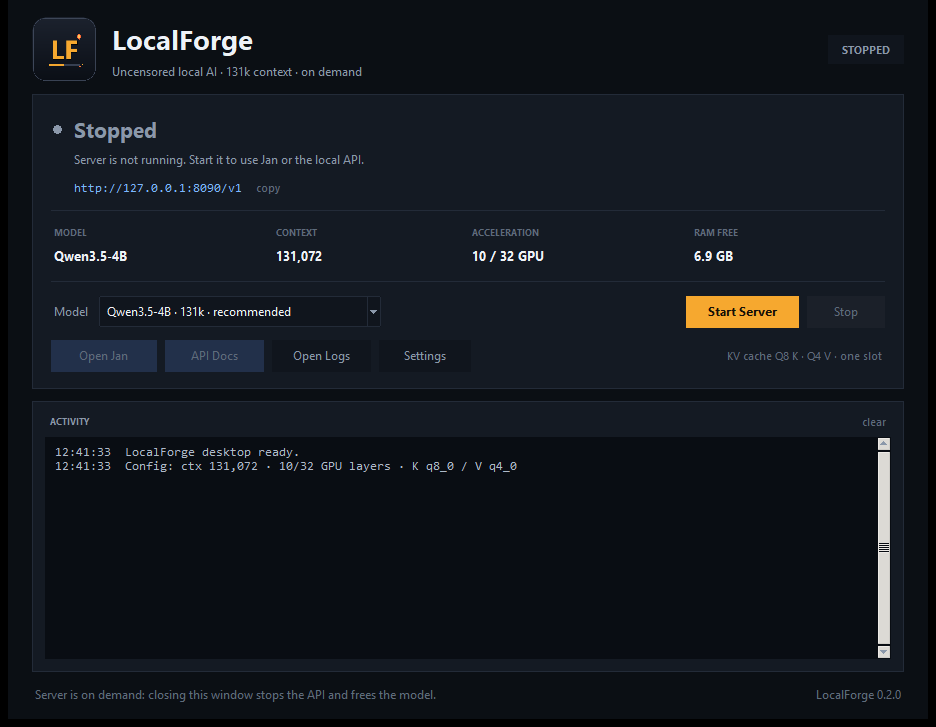
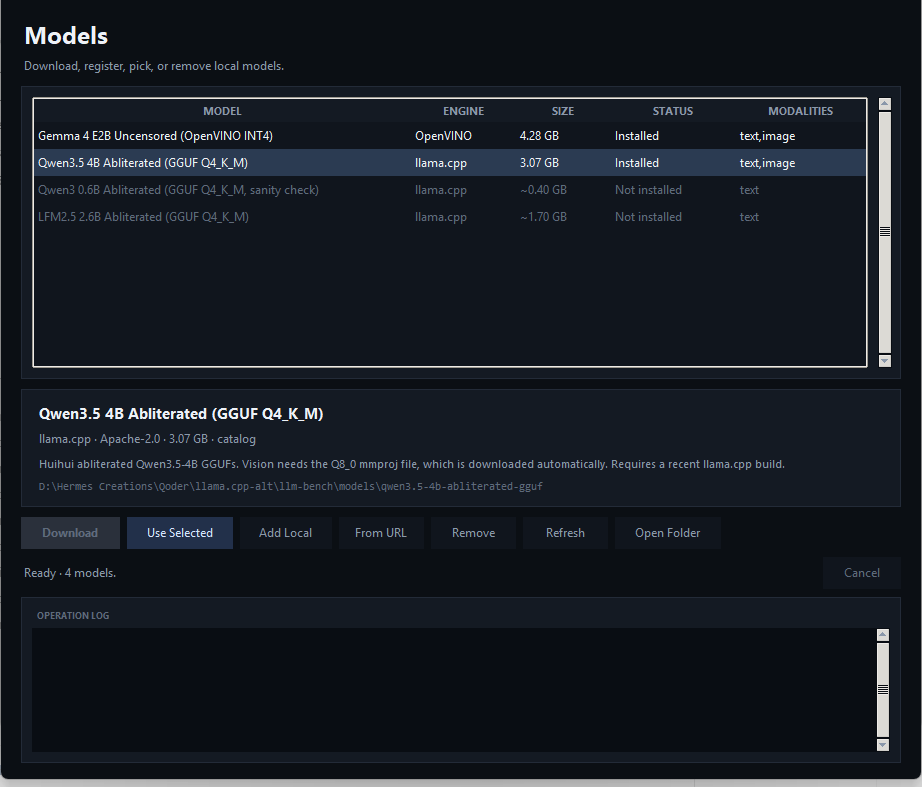

# LocalForge

LocalForge is a Windows desktop app, CLI, and local OpenAI-compatible API for running
uncensored/abliterated multimodal models. It uses **OpenVINO GenAI** for Gemma 4 E2B and
**llama.cpp** for abliterated GGUFs.

[Latest release](https://github.com/solletravinder/localforge/releases/latest)

## Portable installer

Download **`LocalForge-Setup-0.4.0.exe`** from the latest release and run it. It installs per user,
needs no Python installation or terminal, and bundles the Python runtime, dependencies, and
`llama-server.exe`.

The installer is a per-user installation (no admin prompt) and is about 515 MB compressed; the
installed runtime is about 1.1 GB. It includes an abliterated **Qwen3 0.6B sanity model** at 8K
context. It is selected automatically on first launch so you can verify the installation
immediately. Download Qwen3.5 4B from the Models window for the full 131k profile.

## Desktop app

Double-click **`LocalForge.exe`** (or the LocalForge desktop shortcut). No terminal is needed.



The window can start and stop the local server, choose the model, show live RAM and context
settings, open Jan, open the API docs, and open the log folder. Closing the window unloads the
model and stops the server, so it stays on demand.

**Settings** has three tabs:

- **Generation:** max output tokens, temperature, top-p, and thinking mode.
- **llama.cpp:** context length, GPU layers, batch, ubatch, CPU threads, parallel slots, flash
  attention, and warmup.
- **KV cache:** K and V cache types, with the 131k memory trade-off shown inline.

Settings are validated, saved to the LocalForge config, and take effect after Stop and Start.

**Models** opens the model manager:



- Lists installed, missing, and locally registered chat models.
- Downloads catalog models with live progress and a cancel control.
- Picks the model used by the main Start button.
- Adds an existing GGUF, OpenVINO, or LiteRT file/folder in place.
- Removes downloaded models or unregisters local models without deleting their files.

Keep `LocalForge.exe` inside the `local-forge` folder: it uses the existing `.venv` and model
directories. In Jan, use base URL `http://127.0.0.1:8090/v1`, model
`qwen3.5-4b-abliterated`, and context `131000`.

### Build the desktop EXE or portable installer

The repository ships the source, not the generated binaries. After setup:

```bat
build-exe.bat
```

It installs PyInstaller into `.venv`, builds a windowed one-file `dist\LocalForge.exe`, and copies
it to the project root. For the self-contained per-user installer:

```bat
build-installer.bat
```

This bundles Python, the dependencies, `llama-server.exe`, and the Qwen3 0.6B sanity model, then
writes `dist\LocalForge-Setup-0.4.0.exe`. Model weights for the larger models are downloaded from
the Models window.

Verified on an i5-12450H, 16 GB RAM, Intel UHD Graphics laptop:

| Model | Engine | Speed | Notes |
|---|---|---:|---|
| Qwen3 0.6B Abliterated Q4_K_M | llama.cpp | sanity check | Bundled with portable installer, 8K context |
| Gemma 4 E2B Uncensored INT4 | OpenVINO CPU | ~18.7 tok/s decode | Text + vision, stable on 16 GB |
| Qwen3.5 4B Abliterated Q4_K_M | llama.cpp 70/30 | ~57 tok/s prefill, ~7 tok/s decode | 131k context, text + vision |
| LFM2.5 2.6B Abliterated Q4_K_M | llama.cpp | not yet validated | Very new build |

Streaming is supported everywhere: CLI token streaming and SSE streaming through the API, for
both OpenVINO and llama.cpp models.

## Requirements

- Windows 10/11, Python 3.10+
- Intel CPU or iGPU supported by OpenVINO 2026.4+
- `llama.cpp` for GGUF models: `winget install ggml.llamacpp`
- The first OpenVINO model load takes 1–2 minutes while the graph compiles. Keep the API
  process running; do not relaunch for every prompt.

## Install

From this folder:

```bat
run.bat setup
```

The first run creates `.venv`, installs dependencies, downloads the two remaining text models, and
installs the photoreal image model (~9.5 GB total). Downloads resume if interrupted; use
`--text-only` or `--image-only` to split them. Then:

```bat
run.bat doctor
```

Or manually:

```powershell
python -m venv .venv
.venv\Scripts\pip install -e .
.venv\Scripts\lforge doctor
```

If you already have models elsewhere, point the app at them:

```powershell
lforge config set models_dir "D:\path\to\models"
```

You can also use `LOCALFORGE_MODELS_DIR` and `LOCALFORGE_HOME` environment variables.

## Models

```powershell
lforge models list
lforge models download gemma4-e2b-uncensored-ov
lforge models download qwen3.5-4b-abliterated
lforge models download lfm2.5-2.6b-abliterated
```

The two GGUF entries are community abliterated builds. If a Hugging Face repository is
unavailable, download the GGUF manually and register it:

```powershell
lforge models add-local my-model "C:\path\model.gguf" --engine llama.cpp --modalities text
```

Local OpenVINO models can be registered too:

```powershell
lforge models add-local my-ov "C:\path\openvino-model" --engine openvino --modalities text,image
```

## Chat

```powershell
lforge chat
lforge chat --model qwen3.5-4b-abliterated --no-thinking
lforge chat --image "C:\path\photo.jpg"
```

In-chat commands:

```text
/model <id>      switch model
/image <path>    attach an image to the next message
/system <text>   change the system prompt
/reset           clear conversation and images
/quit            exit
```

`--no-thinking` passes `enable_thinking: false` to llama.cpp chat templates. It is useful for
Qwen3.5, which otherwise streams its reasoning trace. OpenVINO Gemma does not use that flag.

## Local API

```powershell
lforge serve --port 8090
```

Endpoints:

| Endpoint | Purpose |
|---|---|
| `GET /v1/models` | Installed and catalog models |
| `POST /v1/chat/completions` | Chat, streaming or non-streaming; supports `tools` |
| `POST /v1/images/generations` | Text-to-image, base64 response |
| `GET /health` | Engine and model state |
| `POST /admin/unload` | Free the active model |
| `/docs` | OpenAPI UI |

OpenAI clients use `http://127.0.0.1:8090/v1` as the base URL.

Streaming example:

```powershell
curl -N http://127.0.0.1:8090/v1/chat/completions ^
  -H "Content-Type: application/json" ^
  -d "{\"model\":\"gemma4-e2b-uncensored-ov\",\"messages\":[{\"role\":\"user\",\"content\":\"Hello\"}],\"stream\":true}"
```

Vision request: include an `image_url` content part with an `http(s)` URL or a base64 data URL.
Up to four images per request; 15 MB each.

To disable Qwen thinking through the API:

```json
{
  "model": "qwen3.5-4b-abliterated",
  "messages": [{"role": "user", "content": "Hello"}],
  "stream": true,
  "chat_template_kwargs": {"enable_thinking": false}
}
```

## Tool calling and Jan AI

`POST /v1/chat/completions` accepts OpenAI `tools` and `tool_choice`.

- **Gemma / OpenVINO:** the server passes tools into Gemma's native template and converts the
  model's `<|tool_call>call:...<tool_call|>` output into OpenAI `tool_calls`. Tool results are
  converted back to Gemma's `tool_responses` format, and a final user prompt injects the current
  date. Tool arguments are normalized to the tool's schema: Gemma often emits `queries` or an
  array even when the tool requires `query`, so aliases are mapped and invalid keys are removed.
  This matches Jan's Exa `web_search` tool.
- **Jan native messages:** Jan sends tool calls and results as content parts
  (`type:"tool_call"` with `tool_name`, `input`, and `output`) and nests text under
  `text.value`. LocalForge parses that format too, so the model sees the Exa results on the
  follow-up and answers instead of emitting a raw `<|tool|>` token.
- **Qwen / LFM / llama.cpp:** tools and raw tool-call stream deltas are forwarded directly to
  `llama-server`, which returns native OpenAI `tool_calls`.
- **Streaming:** clients receive a `tool_calls` delta with `finish_reason: "tool_calls"`. Gemma's
  tool call is generated before the SSE response starts, so the call itself is buffered; the
  follow-up answer is also buffered and then chunked. llama.cpp streams normally.
- **Schema robustness:** Jan and other clients send union types like `["string","null"]`, which
  Gemma's Minja template cannot render. LocalForge flattens unions and fills missing descriptions
  before templating, so the model no longer falls back to a generic prompt that leaks `<|tool|>`.

Jan AI setup:

1. Restart the API after updating: `run.bat serve --preload --model qwen3.5-4b-abliterated`.
2. Base URL `http://127.0.0.1:8090/v1`, any API key. For the 131k setup use model
   `qwen3.5-4b-abliterated` and set Jan's model context to `131000`. For a short CPU-only chat,
   `gemma4-e2b-uncensored-ov` is still available.
3. Enable Jan's web search/tools. The model returns a structured `web_search` call, Jan executes
   it, and the follow-up contains the result and the current date.

If Jan still shows raw text like `call:web_search{...}`, it is either an old server process on
port 8090 or Jan is not sending its `tools` array. Stop the old process, restart, and confirm the
request has `tools`.

Tool argument quality depends on the model. Gemma 4 E2B can call tools, but Qwen3.5-4B is more
reliable with complex schemas. Property descriptions improve Gemma's formatted tool declaration;
LocalForge fills missing descriptions automatically.

## Image generation

An SD1.5 image model is configured and working immediately. **`run.bat setup` upgrades it to
Realistic Vision V6.0 B1**, a photoreal SD1.5 checkpoint exported to OpenVINO FP16. It has no
built-in content filter and is suitable for portrait and boudoir-style photography. Defaults are
portrait 512×768, 28 steps, guidance 6.5, with a built-in negative prompt.

```powershell
run.bat image "editorial portrait of an adult, soft window light, 85mm lens, natural skin texture"
```

The app runs OpenVINO `Text2ImagePipeline` models. To use another SD1.5/SDXL diffusers checkpoint
(including an uncensored community fine-tune), export it:

```powershell
pip install "optimum-intel[openvino]"
lforge convert-image --model "C:\path\to\diffusers-checkpoint" --out "models\sd15-ov" --set-config
lforge image "your prompt" --model-path "models\sd15-ov"
```

For a 16 GB UHD laptop, SD1.5 at 512×768 is realistic. SDXL works but is slow; avoid Flux/SD3.
The aligned base SD1.5 OpenVINO model is useful only for runtime smoke tests, not for photoreal
boudoir.

## Configuration

```powershell
lforge config show
lforge config set openvino_device CPU   # safest on 16 GB when Jan/Qoder are open
lforge config set llama_ngl 10
lforge config set llama_ctx 131072
lforge config set llama_ubatch 1024
lforge config set llama_parallel 1
lforge config set llama_flash_attn on
lforge config set llama_cache_k q8_0
lforge config set llama_cache_v q4_0
lforge config set api_port 8090
```

On this 16 GB laptop, keep Gemma on **CPU**. The 4.3 GB model in shared GPU memory plus
Jan/Qoder can exhaust the iGPU's ~8 GB shared allocation. CPU measured 18.7 tok/s decode for
Gemma 4 E2B and avoids that failure. The same device setting applies to image generation; CPU
images are slower but stable. To try GPU images, stop the chat server first and switch the device.

Qwen3.5-4B runs with a 131,072-token context, 10 of 32 layers on the iGPU, one slot, Flash
Attention on, and a Q8 K / Q4 V cache. This fits with about 3 GB of RAM free. The full 131k KV
cache is allocated at load time, so memory stays stable; the expensive part is the first cold
prefill, which takes tens of minutes to hours at the 4B hybrid model's speed on UHD graphics.
Prompt caching makes later turns in the same thread cheap. Dial `llama_ctx` down to 32768 for a
faster interactive session, or raise `llama_cache_v` to `q8_0` for maximum cache quality.

## How it works

```text
src/local_forge/
  api.py              OpenAI-compatible FastAPI server
  cli.py              lforge commands and interactive chat
  config.py           JSON config and paths
  catalog.py          Uncensored model catalog
  manager.py          Downloads, local imports, status, deletion
  hardware.py         CPU/RAM/GPU/OpenVINO/llama.cpp detection
  schemas.py          OpenAI request parsing and image handling
  tools.py            Gemma tool-call parser and tool-history conversion
  engines/
    openvino_engine.py   VLMPipeline, streaming, vision
    llama_cpp_engine.py  llama-server lifecycle and SSE proxy
    image_engine.py      OpenVINO Text2ImagePipeline
    manager.py           One-resident-model policy
```

Only one chat engine is kept resident at a time. Switching models unloads the previous one so the
4.3 GB Gemma pipeline and a llama.cpp server do not compete for 16 GB of RAM.

## LiteRT-LM engine (validated bundles only)

LocalForge includes a first-class LiteRT-LM adapter that uses LiteRT's native Conversation
API. It does **not** edit chat templates or parse raw tool text.

Install the optional runtime and register a local bundle:

```powershell
pip install -e ".[litert]"
lforge models add-local lfm-litert "C:\path\model.litertlm" --engine litert --modalities text,image
lforge config set litert_backend GPU
lforge config set litert_ctx 4096
lforge config set litert_validate_tools true
```

On load, the adapter:

1. Renders a probe message with the bundle's embedded template. If the runtime cannot render it,
   the bundle is rejected with a clear error.
2. Runs a native tool probe. Tool requests are routed only if the runtime returns real
   `tool_calls`. Otherwise the API returns 501 — it does not parse `<|tool_call|>` text.

The current community LFM2.5-VL-3B heretic LiteRT bundle (`stuarch`) is rejected by this gate: its
embedded Jinja template uses unsupported ``/`.get()` syntax. The Calandracas Gemma
4 E2B QAT heretic LiteRT bundle is also rejected for the same class of issue (`map.get` in its
template). The official LFM2.5-VL-3B LiteRT bundle loads, but its metadata declares **no
function-call support**, so a clean conversion of the heretic weights would be chat-only. The
official Gemma 4 E2B LiteRT control passes the template and native-tool probes and completes a
tool-call round-trip, but it is aligned, not uncensored.

There is currently no validated uncensored LiteRT bundle with native tools. Qwen via llama.cpp
remains the production Jan tool engine; the LiteRT adapter is ready for a future compatible bundle.

## Limitations


- No GUI; the interface is CLI + API by design.
- Image generation requires a converted OpenVINO IR checkpoint; none is bundled.
- On 16 GB, run one large model at a time. The OpenVINO chat model now defaults to CPU to avoid
  iGPU shared-memory OOM; stop it before loading the image model on GPU.
- Tool calling works, but small models can produce imperfect tool arguments. Gemma tool calls are
  buffered rather than token-streamed; llama.cpp streams them.
- LFM2.5 2.6B abliterated is a very fresh community build; validate quality and tool calling.
- Qwen3.5 vision needs an mmproj file in the GGUF folder; otherwise the app correctly reports
  text-only.
- The API has no authentication. It binds to 127.0.0.1 by default. Do not expose it publicly.
- Abliteration removes refusal behavior but does not guarantee quality or safety.

## Disclaimer

These are uncensored community models with no content filter. You are responsible for what you
generate and for complying with the law where you live. Model licenses are set by their
publishers; check them before commercial use.
